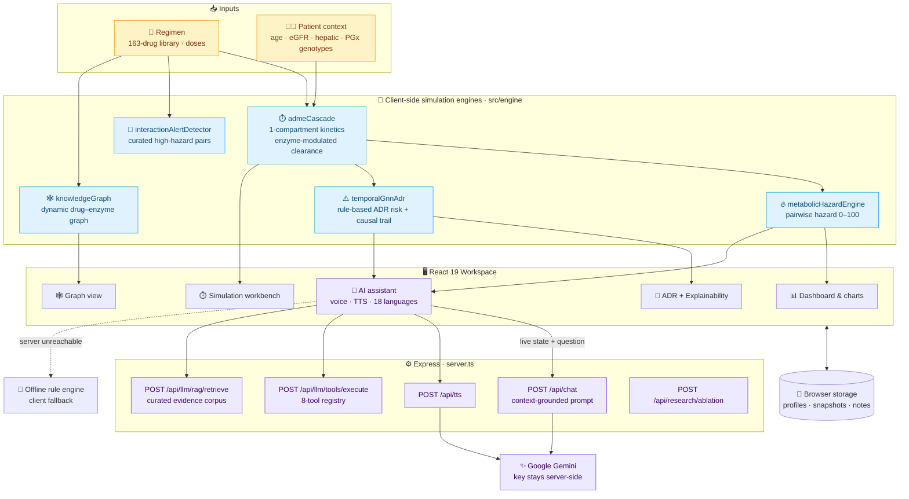
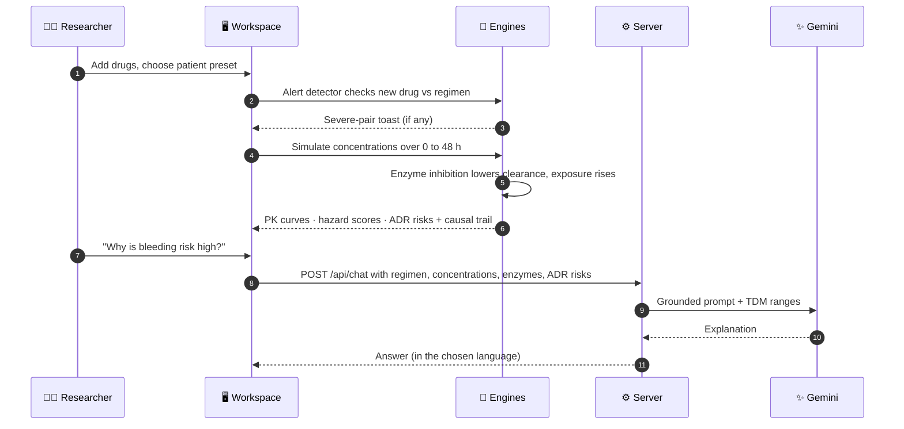

<div align="center">

<br/>

# 🧬 PolyPharm-Twin

### A Dynamic Digital Twin for Multi-Drug Metabolic Cascade, Interaction & Adverse Drug Reaction Simulation

**ADME kinetics · CYP enzyme inhibition · Drug-interaction hazard scoring · Explainable ADR risk · Knowledge graph · Multilingual AI assistant**

<br/>

<a href="https://poly-pharm-twin.vercel.app/">
  
</a>

<br/><br/>


<br/>

**[🌐 Live Demo](https://poly-pharm-twin.vercel.app/)** &nbsp;│&nbsp;
**[✨ Capabilities](#-capabilities)** &nbsp;│&nbsp;
**[🏗️ Architecture](#️-architecture)** &nbsp;│&nbsp;
**[🔬 Engines](#-simulation-engines)** &nbsp;│&nbsp;
**[🤖 AI Layer](#-ai-assistant--tool-layer)** &nbsp;│&nbsp;
**[🚀 Quick Start](#-quick-start)** &nbsp;│&nbsp;
**[📡 API](#-api-reference)** &nbsp;│&nbsp;
**[🗺️ Roadmap](#️-roadmap)**

<br/>

> Patients rarely take one drug. **PolyPharm-Twin** lets you build a regimen, pick a patient profile and *watch* how the drugs compete for the same enzymes over time, where concentrations spike, which adverse reactions become likely and **why**.

<br/>

</div>

---

<div align="center">

## 📖 Overview

</div>

<div align="center">

Polypharmacy is one of the most common causes of preventable adverse drug events. When two drugs share a metabolic pathway such as **CYP3A4** or **CYP2C9**, one can slow the clearance of the other and push it into a toxic range.
**PolyPharm-Twin** models that cascade in the browser: **163 drugs**, **8 metabolic enzymes and transporters**, **12 patient presets** (renal, hepatic, elderly, pharmacogenomic variants) and **18 UI languages**, with every prediction accompanied by a causal explanation trail.

</div>

<br/>

<div align="center">

| 💊 Drug library | 🧪 Enzymes & transporters | 🧑‍⚕️ Patient presets | 🌍 Languages | 🛠️ AI tools |
|:---:|:---:|:---:|:---:|:---:|
| **163** | **8** | **12** | **18** | **8** |

</div>

> ⚠️ **Research & education only.** PolyPharm-Twin is an *in silico* simulation. It is not a medical device and must not guide real prescribing or dosing decisions.

---

<div align="center">

## ✨ Capabilities

</div>

<div align="center">

| | Workspace | What it does |
|:---:|:---|:---|
| 📊 | **Dashboard** | Regimen summary, PK chart and live hazard overview |
| 💊 | **Medicine library** | Searchable library of 163 drugs across cardio, CNS, antimicrobial, metabolic and oncology classes |
| 🧑‍⚕️ | **Patient profiles** | Presets plus custom patients: age, weight, eGFR, hepatic function, CYP2D6/2C9/2C19, SLCO1B1 and VKORC1 genotypes, albumin, comorbidities |
| ⏱️ | **Simulation workbench** | Adjustable doses, plasma-concentration curves, event timeline, regimen snapshots and side-by-side comparison |
| 🔥 | **Metabolic hazard engine** | Pairwise hazard score (0–100) with enzyme activity, inhibition %, fold exposure increase and a configurable alert threshold |
| 🚨 | **Real-time interaction alerts** | Toast alerts the moment a contraindicated or major pair is added |
| 🕸️ | **Knowledge graph** | Drug → enzyme → metabolite → target graph generated from the active regimen |
| 🧪 | **Enzyme monitoring** | Live CYP activity, inhibition and induction status |
| ⚠️ | **ADR prediction + XAI** | Organ-level risks (bleeding and more) with step-by-step causal trails and attention-style importance scores |
| 🤖 | **AI assistant** | Gemini chat grounded in the live simulation state, with voice input and text-to-speech |
| 🔬 | **Research mode** | Ablation analysis and a training-range modal for the LLM profile |
| 🗒️ | **Clinical notes & sticky notes** | Annotate regimens; export a report |
| 🌐 | **Multilingual UI** | English, Tamil, Hindi, Telugu, Malayalam, Kannada, Bengali, Marathi, Gujarati, Punjabi, Urdu, Spanish, French, German and more |

</div>

---

<div align="center">

## 🏗️ Architecture

</div>



<div align="center">

### 🔁 From a Regimen to an Explanation

</div>



<div align="center">

### 🧱 Layered Design

| Layer | Responsibility | Location |
|:---|:---|:---|
| **Data** | Drugs, enzymes, patient presets, dosage guidelines, therapeutic ranges, translations | `src/data/` |
| **Engine** | Pure TypeScript simulation: kinetics, hazard, alerts, ADR risk, graph | `src/engine/` |
| **Services** | Chat client, tool layer, voice, storage, language, AI config | `src/services/` |
| **UI** | Panels, charts, modals, navigation | `src/components/` |
| **Server** | Gemini proxy, tools, evidence retrieval, ablation | `server.ts` |
| **Pipeline** | Offline LoRA training and evaluation scripts | `pipeline/` |

</div>

---

<div align="center">

## 🔬 Simulation Engines

</div>

<div align="center">

| Engine | How it works |
|:---|:---|
| **ADME cascade** `admeCascade.ts` | Analytical one-compartment model with first-order absorption (Bateman function) plus a metabolite compartment. Clearance is scaled by live enzyme activity, so inhibitors raise exposure and inducers lower it. Dose ranges and defaults are per drug. |
| **Metabolic hazard** `metabolicHazardEngine.ts` | Evaluates every active drug pair using live concentrations, CYP inhibition/induction flux and pharmacogenomics. Outputs a 0–100 score (default alert threshold **65**), severity, enzyme activity %, inhibition %, fold exposure increase, suggested alternative and evidence source. |
| **Interaction alerts** `interactionAlertDetector.ts` | Curated table of contraindicated and major pairs (e.g. amiodarone + simvastatin) with mechanism, clinical risk and recommended action; fires when a drug is added. |
| **ADR prediction** `temporalGnnAdr.ts` | Organ-level toxicity models (bleeding and others) combining class, enzyme-inhibition and patient context into a probability, with an ordered causal trail and attention-style importance scores per step. |
| **Knowledge graph** `knowledgeGraph.ts` | Builds drug, enzyme, metabolite and target nodes and typed edges from the active regimen and lays them out for the graph view. |

</div>

> **Transparency:** the "TGNN" ADR module is a **deterministic, rule-based risk model** written in TypeScript. It uses graph-style reasoning and attention-style scores for explanation, but it is **not a trained neural network**, and the kinetic model is a simplified one-compartment approximation, not a full PBPK simulator.

---

<div align="center">

## 🤖 AI Assistant & Tool Layer

</div>

<div align="center">

The assistant is **grounded in the live simulation**. Each question is sent with the regimen, patient context, current concentrations, enzyme status and ADR risks, plus narrow-therapeutic-index reference ranges (warfarin INR 2.0–3.0, digoxin 0.5–0.9 ng/mL, phenytoin 10–20 mg/L, and others).

| Registered tool | Purpose |
|:---|:---|
| `search_drug_information` | Look up a drug |
| `resolve_drug_identifiers` | Map names and synonyms to library IDs |
| `find_pairwise_interactions` | Check one drug pair |
| `inspect_multidrug_regimen` | Audit a whole regimen for a patient |
| `retrieve_metabolic_pathways` | Enzyme pathways for selected drugs |
| `run_adme_simulation` | Run the kinetic engine |
| `predict_adverse_events` | Run the ADR engine |
| `explain_prediction` | Return the causal trail |

</div>

- **Modes & controls:** clinical-reasoning mode, knowledge scope, vigilance level, temperature and thinking budget are configurable.
- **Voice:** browser speech recognition for input; `/api/tts` for spoken replies.
- **Evidence retrieval:** `/api/llm/rag/retrieve` returns cited snippets from a small curated corpus (e.g. CPIC warfarin guidance) and says so when evidence is missing.
- **Graceful fallback:** if the server is unreachable, the chat client switches to an offline rule engine (`source: offline-rule-engine`).

---

<div align="center">

## 🧰 Tech Stack

</div>

<div align="center">

| Layer | Technology |
|:---:|:---|
| 🎨 **Frontend** | React 19 · TypeScript · Vite 8 · Tailwind CSS 4 · Recharts 3 · Motion · Lucide Icons |
| ⚙️ **Server** | Node.js · Express 4 · `tsx` · esbuild bundle · dotenv |
| ✨ **AI** | Google Gen AI SDK (`@google/genai`), server-side key |
| 🐍 **Offline pipeline** | Python · PyTorch · Transformers · PEFT · TRL · bitsandbytes (QLoRA) |
| ☁️ **Hosting** | Vercel |

</div>

---

<div align="center">

## 🚀 Quick Start

**Prerequisites:** Node.js 18+

</div>

```bash
git clone https://github.com/sathi2305/PolyPharm-Twin.git
cd PolyPharm-Twin

npm install --legacy-peer-deps
cp .env.example .env            # add GEMINI_API_KEY for live AI chat and TTS
npm run dev                     # → http://localhost:3000
```

<details>
<summary><b>⚙️ Environment variables</b></summary>

| Variable | Purpose |
|:---|:---|
| `GEMINI_API_KEY` | Enables live Gemini chat and text-to-speech |
| `APP_URL` | Public URL of the app (used for self-referential links) |
| `PORT` | Server port (default `3000`) |

</details>

<details>
<summary><b>📜 Scripts</b></summary>

| Command | What it does |
|:---|:---|
| `npm run dev` | Express + Vite dev server |
| `npm run build` | Vite build and bundle `server.ts` to `server.js` |
| `npm start` | Run the bundled production server |
| `npm run lint` | Type-check (`tsc --noEmit`) |

</details>

<details>
<summary><b>🐍 Run the LoRA pipeline (optional, needs a GPU for real training)</b></summary>

```bash
cd pipeline
python -m venv venv && source venv/bin/activate        # Windows: .\venv\Scripts\Activate.ps1
pip install torch transformers peft trl bitsandbytes datasets accelerate scikit-learn
python prepare_datasets.py
python train_lora.py
python evaluate_model.py
python rag_engine.py
```

Config: Llama-3.1-8B-Instruct (or Qwen2.5-7B-Instruct), 4-bit NF4 QLoRA, r=16, α=32, 3 epochs, cosine schedule. See `pipeline/README.md` for the VRAM budget table.

</details>

---

<div align="center">

## 📡 API Reference

</div>

<div align="center">

| Method | Endpoint | Purpose |
|:---:|:---|:---|
| `GET` | `/api/health` | Health check |
| `POST` | `/api/chat` | Simulation-grounded Gemini chat |
| `POST` | `/api/tts` | Text-to-speech |
| `POST` | `/api/llm/tools/execute` | Run one of the 8 registered tools |
| `GET` | `/api/llm/status` | Assistant and tool registry status |
| `POST` | `/api/llm/rag/retrieve` | Cited evidence retrieval |
| `GET` | `/api/llm/eval/results` | Benchmark payload shown in the Research panel |
| `POST` | `/api/research/ablation` | Research-mode ablation analysis |

</div>

---

<div align="center">

## 📁 Project Structure

</div>

```text
PolyPharm-Twin/
├── server.ts                   # Express API (Gemini proxy, tools, retrieval)
├── src/
│   ├── App.tsx                 # tabs: dashboard · medicines · patients · simulation ·
│   │                           #       knowledge graph · enzymes · ADR/XAI · assistant · research
│   ├── engine/                 # admeCascade · metabolicHazardEngine · interactionAlertDetector
│   │                           # temporalGnnAdr · knowledgeGraph
│   ├── services/               # chat · polypharmToolLayer · voice · storage · language · aiConfig
│   ├── data/                   # medicines/ (163 drugs) · enzymes · patient presets ·
│   │                           # dosage guidelines · therapeutic ranges · translations
│   ├── components/             # 27 panels, charts and modals
│   └── context/                # language context
├── pipeline/                   # QLoRA training, evaluation and RAG scripts, model card
└── .env.example
```

---

<div align="center">

## 🌐 Deployment

**Live now:** [**poly-pharm-twin.vercel.app**](https://poly-pharm-twin.vercel.app/)

</div>

- The simulation engines run **entirely in the browser**, so every simulation, alert, graph and ADR panel works on a static host.
- The AI endpoints (`/api/*`) live in the Express server. The repo has no `vercel.json` or serverless functions, so on a purely static Vercel deploy the assistant uses its offline fallback. For live Gemini answers, host `server.ts` (`npm run build && npm start`) or move the routes into Vercel functions.

---

<div align="center">

## ⚖️ Validation & Transparency

</div>

| Area | Status |
|:---|:---|
| **Type-check** | `tsc --noEmit` passes; production build succeeds (with `--legacy-peer-deps`) |
| **Kinetics** | Simplified one-compartment model; not validated against clinical PK data |
| **ADR / hazard scores** | Rule-based, curated interactions; not statistically validated |
| **LLM benchmark figures** | The numbers in `pipeline/model_card.md`, `evaluate_model.py` and `/api/llm/eval/results` (e.g. factual correctness 95.8%, GNN AUROC 0.978) are **fixed values written into the source**, not outputs of a run in this repo. They are illustrative targets, not measured results |
| **Trained adapter** | No LoRA weights are included; the pipeline is provided as reproducible scripts. The sample dataset has 4 records |
| **Assistant status** | `/api/llm/status` reports static values (for example, an indexed-document count), not live index stats |
| **Evidence corpus** | Small curated set of snippets, not the full DrugBank, TwoSIDES or CPIC databases |

---

<div align="center">

## 🗺️ Roadmap

</div>

<div align="center">

| Status | Item |
|:---:|:---|
| ✅ | ADME kinetics, hazard scoring, interaction alerts, ADR explainability, knowledge graph |
| ✅ | Context-grounded multilingual AI assistant with tool layer and voice |
| 🔜 | Run the QLoRA pipeline on real data and replace the fixed benchmark values with measured ones |
| 🔜 | Serverless API routes so live AI works on the Vercel deployment |
| 🔜 | Numerical multi-compartment / PBPK solver |
| 🔜 | Trained graph model on public pharmacovigilance data (e.g. TwoSIDES) |
| 💡 | Import real DrugBank and CPIC records into the retrieval index |
| 💡 | Unit tests for the engines and a CI pipeline |

</div>

---

<div align="center">

## 🤝 Contributing

**Fork** → **Branch** (`feature/your-idea`) → **Commit** → **Push** → **Open a Pull Request**

<br/>

## 📄 License

No license file has been added yet. Add a `LICENSE` file (for example MIT) to define reuse terms.

</div>

---

<div align="center">

## 👨‍💻 Author

**Sathiyamoorthi** · [@sathi2305](https://github.com/sathi2305)

<br/>

> ⚠️ **Disclaimer:** PolyPharm-Twin is an in silico research and education tool. Outputs are not medical advice and must not replace professional clinical judgement.

<br/>

<a href="https://poly-pharm-twin.vercel.app/">
  
</a>

<br/><br/>

**⭐ If this project is useful, please star the repo! ⭐**

<sub>Made with ❤️ for safer polypharmacy research</sub>

</div>
